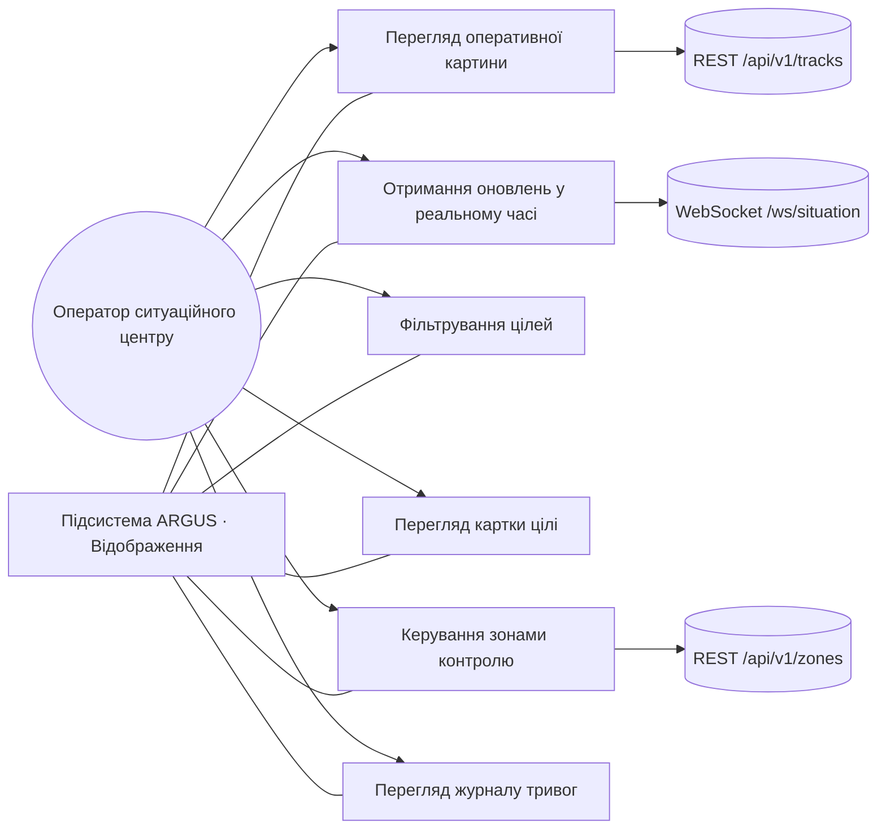

# Діаграма варіантів використання

## Актори

| Актор | Роль |
|---|---|
| Оператор | Приймає рішення на основі картини, керує зонами |
| Джерело даних | РЛС / ADS-B / AIS через шар фузії |
| Сервіс ARGUS | Надає REST і WebSocket інтерфейси |
