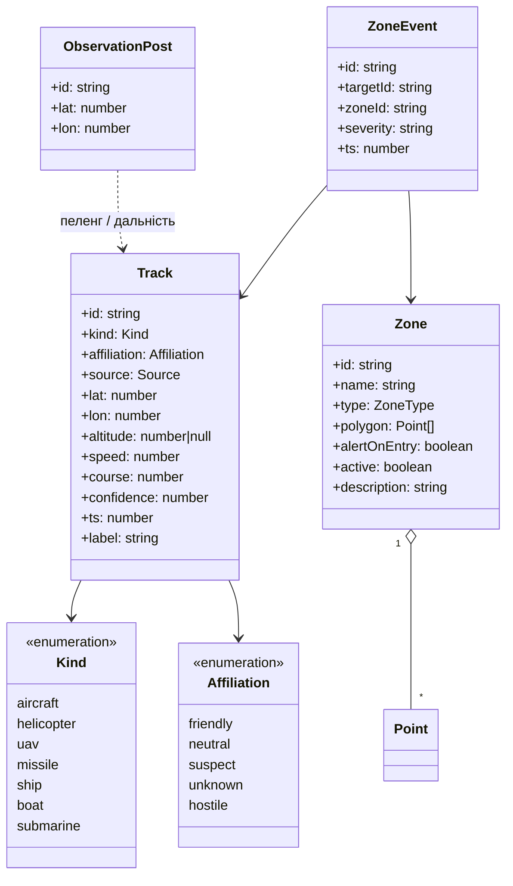

# Діаграма класів (доменна модель)

## Доменні інваріанти

- `course ∈ [0, 360)`, `confidence ∈ [0, 1]`, `speed ≥ 0`.
- `altitude` задано лише для повітряних цілей (`domain = air`).
- Полігон зони містить щонайменше 3 точки.
- Подія входу створюється один раз для пари `(targetId, zoneId)`.
